# SYSTEM ARCHITECTURE SPECIFICATION: RIDE-HAILING MICROSERVICES (DS03)

## 1. Sơ Đồ Kiến Trúc Tổng Thể

Hệ thống được thiết kế theo mô hình Microservices hướng sự kiện (Event-Driven Microservices Architecture). Các dịch vụ được chia tách theo ranh giới nghiệp vụ (Bounded Contexts) và triển khai độc lập trong các Docker containers riêng rẽ:

```
                                  [ Web Client / Simulation UI ]
                                                │
                                                │ HTTP / REST / SSE
                                                ▼
                                    ┌───────────────────────┐
                                    │      API GATEWAY      │
                                    │     (Port 8080)       │
                                    │ • Request Routing     │
                                    │ • Reverse Proxy       │
                                    │ • JWT Verification    │
                                    │ • Sinh Correlation-ID │
                                    └───────────┬───────────┘
                                                │
       ┌───────────────────────┬────────────────┼───────────────────────┬───────────────────────┐
       ▼                       ▼                │                       ▼                       ▼
┌──────────────┐      ┌─────────────────┐       │              ┌─────────────────┐     ┌─────────────────┐
│ Identity/User│      │ Driver/Location │       │              │  Trip/Booking   │     │Simulated Payment│
│   Service    │      │     Service     │       │              │     Service     │     │     Service     │
│ (Port 8001)  │      │   (Port 8002)   │       │              │   (Port 8003)   │     │   (Port 8005)   │
└──────┬───────┘      └────────┬────────┘       │              └────────┬────────┘     └────────┬────────┘
       │                       │                │                       │                       │
┌──────▼───────┐      ┌────────▼────────┐       ▼              ┌────────▼────────┐     ┌────────▼────────┐
│   user_db    │      │    driver_db    │ ┌───────────┐        │     trip_db     │     │   payment_db    │
│ (PostgreSQL) │      │  (PostgreSQL)   │ │ Matching  │        │  (PostgreSQL)   │     │  (PostgreSQL)   │
└──────────────┘      └────────┬────────┘ │  Service  │        └────────┬────────┘     └────────┬────────┘
                               │          │(Port 8004)│                 │                       │
                               │          └─────┬─────┘                 │                       │
                               │  REST Query    │                       │                       │
                               └────────────────┘                       │                       │
                                       │                                │                       │
                                       ▼                                ▼                       ▼
                             ═════════════════════════════════════════════════════════════════════════
                                                RABBITMQ MESSAGE BROKER (AMQP)
                                  Exchange: trip.exchange (Topic)
                                  Queues: matching.queue, payment.queue, trip.queue, notification.queue
                                  Dead-Letter Exchange (DLX): trip.dlx -> Queue: trip.dlq
                             ═════════════════════════════════════════════════════════════════════════
```

---

## 2. Đặc Tả Các Microservices & Database-Per-Service

Theo nguyên tắc bất khả xâm phạm của kiến trúc Microservices trong môn Hệ Phân Tán: **Mỗi service sở hữu cơ sở dữ liệu riêng, không có bất kỳ kết nối chéo DB nào**.

| Tên Microservice | Port | Database | Ranh giới Trách nhiệm & Dữ liệu quản lý |
|---|---|---|---|
| **API Gateway** | 8080 | Không có DB | Cửa ngõ duy nhất đón nhận request từ Client. Sinh `X-Correlation-ID`, kiểm tra JWT token, chuyển tiếp request đến các internal service qua mạng HTTP nội bộ. Hỗ trợ Server-Sent Events (SSE) để stream log trực quan về UI. |
| **Identity Service** | 8001 | `user_db` (Postgres) | Đăng ký, đăng nhập, băm mật khẩu `bcrypt`, cấp phát JWT token mang role `DRIVER` hoặc `PASSENGER`. |
| **Driver Location Service** | 8002 | `driver_db` (Postgres) | Quản lý thông tin hồ sơ tài xế, trạng thái (`AVAILABLE`, `BUSY`, `OFFLINE`), toạ độ GPS giả lập `(lat, lon)`. Cung cấp API truy vấn tài xế khả dụng theo toạ độ. |
| **Trip Booking Service** | 8003 | `trip_db` (Postgres) | Quản lý toàn bộ vòng đời chuyến đi. Chứa **Dynamic Pricing Engine** và **Outbox Pattern Table**. Điều phối luồng Saga giao dịch phân tán. |
| **Matching Service** | 8004 | `match_db` (Postgres) | Tiếp nhận yêu cầu tìm xe, truy vấn danh sách tài xế gần điểm đón, thực hiện **PostgreSQL Concurrency Lock** để độc quyền tài xế cho một cuốc xe duy nhất. |
| **Payment Service** | 8005 | `payment_db` (Postgres) | Quản lý ví ảo của khách hàng. Thực hiện 3 thao tác giao dịch: `Hold` (tạm giữ số dư), `Capture` (trừ tiền khi hoàn thành chuyến), `Refund/Release` (bù trừ trả lại tiền nếu huỷ cuốc). |

---

## 3. Cơ Chế Giao Tiếp (Communication Protocols)

Hệ thống kết hợp cả hai mô hình giao tiếp để tối ưu hoá tính đồng thời và khả năng mở rộng:

### 3.1. Giao Tiếp Đồng Bộ (Synchronous Communication - HTTP/REST)
* **Client $\leftrightarrow$ API Gateway $\leftrightarrow$ Services:** Cho các tác vụ truy vấn tức thì (Query) hoặc các tác vụ nghiệp vụ có phản hồi ngay:
  * Khách hàng đăng nhập / đăng ký.
  * Tài xế cập nhật vị trí GPS.
  * Khách hàng gửi lệnh tạo cuốc xe (`POST /api/v1/trips`) $\rightarrow$ nhận về ngay `trip_id` với trạng thái ban đầu `REQUESTED`.
* **Matching Service $\rightarrow$ Driver Service:** Khi Matching Service cần lấy danh sách toạ độ các tài xế đang `AVAILABLE` trong bán kính.

### 3.2. Giao Tiếp Bất Đồng Bộ (Asynchronous Communication - RabbitMQ)
* Dùng cho tất cả các luồng xử lý sự kiện, thay đổi trạng thái cuốc xe, thanh toán và thông báo.
* **Topic Exchange (`trip.exchange`)**:
  * Routing key: `trip.event.created` $\rightarrow$ Đẩy vào `matching.queue`.
  * Routing key: `trip.event.driver_matched` $\rightarrow$ Đẩy vào `payment.queue` & `trip.queue`.
  * Routing key: `payment.event.hold_success` $\rightarrow$ Đẩy vào `trip.queue`.
  * Routing key: `payment.event.hold_failed` $\rightarrow$ Đẩy vào `trip.queue` (kích hoạt bù trừ).
  * Routing key: `trip.event.completed` $\rightarrow$ Đẩy vào `payment.queue` (trừ tiền chính thức).

---

## 4. Giải Quyết Các Bài Toán Hệ Phân Tán Trọng Yếu

### 4.1. Concurrency Control: Ngăn Chặn 2 Khách Đặt Cùng 1 Tài Xế
* **Tình huống xảy ra tranh chấp (Race Condition):**
  * Hành khách $P_1$ và Hành khách $P_2$ cùng gửi yêu cầu đặt xe tại vị trí gần tài xế $D_1$.
  * Cả hai yêu cầu đều được đẩy tới Matching Service gần như cùng mili-giây.
* **Giải pháp: PostgreSQL Row-Level Lock với `FOR UPDATE SKIP LOCKED`**:
  * Khi Matching Service chạy truy vấn tìm tài xế khả dụng gần nhất cho $P_1$, câu lệnh SQL được thực thi trong một transaction:
    ```sql
    BEGIN;
    SELECT id, user_id, latitude, longitude, status, version 
    FROM drivers 
    WHERE status = 'AVAILABLE' 
    ORDER BY ( (latitude - $pickup_lat)^2 + (longitude - $pickup_lon)^2 ) ASC 
    LIMIT 1 
    FOR UPDATE SKIP LOCKED;
    
    -- Cập nhật trạng thái thành BUSY và tăng version
    UPDATE drivers 
    SET status = 'BUSY', version = version + 1, updated_at = NOW() 
    WHERE id = $selected_driver_id;
    COMMIT;
    ```
  * **Cơ chế hoạt động**:
    1. Transaction của $P_1$ khoá dòng dữ liệu của tài xế $D_1$.
    2. Cùng lúc đó, transaction của $P_2$ chạy tới. Thay vì bị block chờ (gây timeout) hoặc đọc phải dữ liệu cũ, từ khoá `SKIP LOCKED` sẽ tự động bỏ qua dòng $D_1$ đang bị lock, và chọn tài xế khả dụng tiếp theo $D_2$.
    3. Nếu không còn tài xế nào khác, query của $P_2$ trả về rỗng $\rightarrow$ Hệ thống phản hồi ngay cho $P_2$ là "Chưa có tài xế phù hợp", tuyệt đối không có chuyện cả $P_1$ và $P_2$ cùng được ghép với $D_1$.

---

### 4.2. Giao Dịch Phân Tán (Saga Pattern) & Compensating Actions

Áp dụng mô hình **Saga Choreography kết hợp Orchestration trạng thái trong Trip Service**:

```mermaid
sequenceDiagram
    autonumber
    participant Client
    participant TripService as Trip Service (Saga Coordinator)
    participant MatchingService as Matching Service
    participant DriverService as Driver Service
    participant PaymentService as Payment Service

    Client->>TripService: POST /trips (Đặt xe)
    Note over TripService: Tạo Trip (State: REQUESTED)<br>Lưu Outbox -> Bắn TripCreated
    TripService-->>MatchingService: Event: trip.event.created
    
    MatchingService->>DriverService: Tìm & Lock Tài xế (FOR UPDATE SKIP LOCKED)
    alt Tìm thấy và khoá tài xế D1 thành công
        MatchingService-->>TripService: Event: trip.event.driver_matched (Gán D1)
        Note over TripService: Chuyển state: DRIVER_ASSIGNED
        TripService-->>PaymentService: Event: payment.event.hold_requested
        
        alt Khách đủ số dư
            PaymentService->>PaymentService: Tạm giữ tiền (Hold Balance)
            PaymentService-->>TripService: Event: payment.event.hold_success
            Note over TripService: Chuyển state: CONFIRMED
            TripService->>Client: Thông báo xe đang tới đón
        else Khách không đủ số dư / Thẻ lỗi (KÍCH HOẠT SAGA BÙ TRỪ)
            PaymentService-->>TripService: Event: payment.event.hold_failed
            Note over TripService: STATE: CANCELLED (Payment Failed)<br>KÍCH HOẠT COMPENSATING ACTION
            TripService-->>DriverService: Event: trip.event.release_driver (D1)
            Note over DriverService: Đổi trạng thái D1 từ BUSY -> AVAILABLE
            TripService->>Client: Thông báo cuốc xe bị huỷ do lỗi thanh toán
        end
    else Không còn tài xế nào khả dụng
        MatchingService-->>TripService: Event: trip.event.matching_failed
        Note over TripService: Chuyển state: CANCELLED (No Driver Available)
        TripService->>Client: Thông báo không tìm thấy xe
    end
```



---

### 4.3. Transactional Outbox Pattern
* **Vấn đề "Dual-Write":** Nếu cập nhật cơ sở dữ liệu và publish message lên RabbitMQ bằng 2 thao tác rời rạc, một sự cố ngắt điện hoặc mạng chập chờn sẽ khiến DB đã cập nhật nhưng message không tới được RabbitMQ.
* **Giải pháp Outbox:**
  1. Trong cùng 1 Database Transaction của Trip Service:
     ```sql
     BEGIN;
     INSERT INTO trips (id, passenger_id, status, ...) VALUES (...);
     INSERT INTO outbox_events (id, aggregate_type, aggregate_id, event_type, payload, status) 
     VALUES (gen_random_uuid(), 'TRIP', trip_id, 'trip.event.created', payload_json, 'PENDING');
     COMMIT;
     ```
  2. Một tiến trình nền **Outbox Publisher Worker** chạy tuần hoàn đọc các bản ghi `PENDING`, gửi sang RabbitMQ với xác nhận `Publisher Confirms`. Khi RabbitMQ xác nhận đã nhận message, worker cập nhật bản ghi thành `PUBLISHED`.
  3. Đảm bảo 100% tính toàn vẹn **At-least-once delivery**.

---

### 4.4. Dynamic Pricing Engine (Định Giá Động)
Cước phí được tính toán tự động dựa trên toạ độ điểm đón $(lat_1, lon_1)$ và điểm đến $(lat_2, lon_2)$:
1. **Khoảng cách ước tính (Haversine Formula):**
   $$d = 2R \times \arcsin\left(\sqrt{\sin^2\left(\frac{\Delta \phi}{2}\right) + \cos(\phi_1)\cos(\phi_2)\sin^2\left(\frac{\Delta \lambda}{2}\right)}\right)$$
2. **Hệ số tăng giá (Surge Multiplier):**
   $$\text{Surge Multiplier} = \min\left(2.5, \max\left(1.0, 1.0 + \frac{\text{Số cuốc xe PENDING trong 5 phút}}{\max(1, \text{Số tài xế AVAILABLE})} \times 0.2\right)\right)$$
3. **Tổng tiền cước:**
   $$\text{Fare} = \Big(\text{Base\_Fare} + d \times \text{Per\_Km\_Rate}\Big) \times \text{Surge\_Multiplier}$$

---

### 4.5. Độ Tin Cậy & Khả Năng Chịu Lỗi (Fault Tolerance & Dead-Letter Queue)
1. **Idempotency Key / Event ID:**
   * Mỗi message có header `event_id`.
   * Consumer lưu các `event_id` đã xử lý vào bảng `processed_events (event_id, processed_at)`.
   * Nếu nhận lại message trùng lặp (ví dụ do retry mạng), consumer phát hiện đã tồn tại `event_id` $\rightarrow$ bỏ qua xử lý và gửi `basicAck` ngay lập tức.
2. **Bounded Retry & Dead-Letter Queue (DLQ):**
   * Khi consumer gặp lỗi không xử lý được, message được `basicNack(requeue=false)`.
   * Exchange cấu hình đẩy message thất bại sang `trip.dlx` (Dead-Letter Exchange) và lưu vào queue `trip.dlq`.
   * Không làm tắc nghẽn hàng đợi chính, lưu lại toàn bộ payload lỗi để dev điều tra hoặc replay.
3. **Correlation ID:**
   * Mọi request đi qua API Gateway đều được gắn header `X-Correlation-ID: <uuid>`.
   * Khi giao tiếp HTTP nội bộ hoặc bắn message vào RabbitMQ, header `correlation_id` được giữ nguyên.
   * Tất cả log in ra màn hình console đều có format:
     `[TIMESTAMP] [CORRELATION-ID] [SERVICE-NAME] [LEVEL] Message...`
   * Giúp truy vết một hành trình cuốc xe qua 5 microservices chỉ bằng 1 ID duy nhất.
