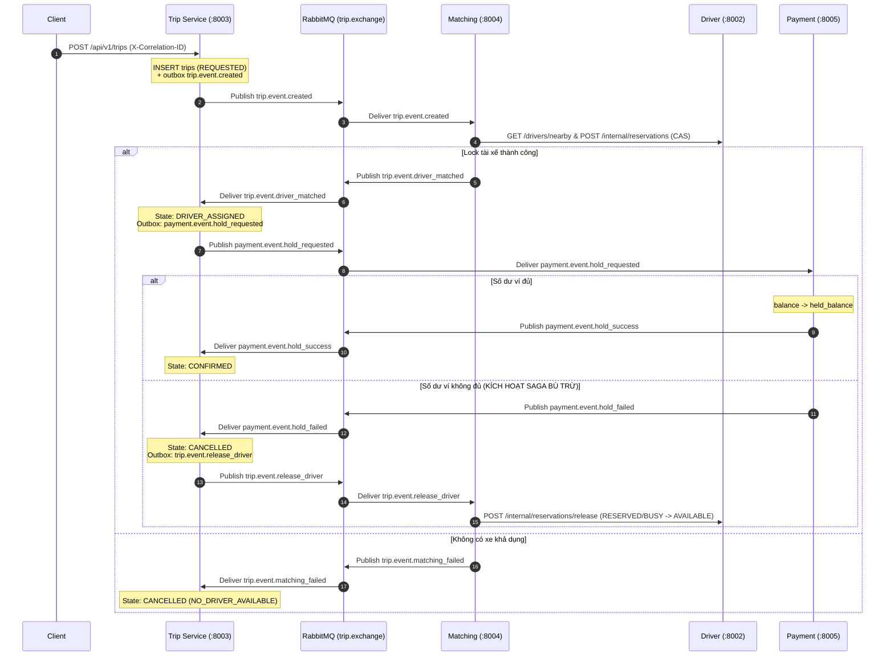

# SYSTEM ARCHITECTURE SPECIFICATION: RIDE-HAILING MICROSERVICES (DS03)

## 1. Sơ Đồ Kiến Trúc Tổng Thể (Bản Final 7.1 – 7.4)

Hệ thống được thiết kế theo mô hình **Event-Driven Microservices Architecture**. Toàn bộ các dịch vụ chạy độc lập trong Docker Compose (`deploy/docker-compose.yml`), tách biệt cơ sở dữ liệu theo nguyên tắc **Database-per-Service** và giao tiếp qua mạng bằng **HTTP/REST** và **RabbitMQ (AMQP 0-9-1)**.

```text
                                 [ Web Simulation Dashboard (:3000) / CLI ]
                                                     │
                                                     │ HTTP / REST / SSE
                                                     ▼
                                        ┌─────────────────────────┐
                                        │    API GATEWAY (:8080)  │ (TV3)
                                        │  • Reverse Proxy        │
                                        │  • Sinh Correlation-ID  │
                                        │  • Broadcast SSE Logs   │
                                        └────────────┬────────────┘
                                                     │
        ┌────────────────────┬───────────────────────┼────────────────────┬────────────────────┐
        ▼                    ▼                       │                    ▼                    ▼
┌──────────────┐      ┌──────────────┐               │             ┌──────────────┐     ┌──────────────┐
│   Identity   │      │    Driver    │               │             │     Trip     │     │   Payment    │
│   Service    │      │   Service    │◄──────────────┼────REST─────┤  (+ Pricing  │     │   Service    │
│  (:8001) TV1 │      │  (:8002) TV2 │  CAS Lock &   │   Confirm   │   & Saga)    │     │  (:8005) TV3 │
└──────┬───────┘      └──────┬───────┘  Reservations │             │  (:8003) TV1 │     └──────┬───────┘
       │                     │                       │             └──────┬───────┘            │
┌──────▼───────┐      ┌──────▼───────┐        ┌──────▼───────┐     ┌──────▼───────┐     ┌──────▼───────┐
│   user_db    │      │  driver_db   │◄─REST──┤   Matching   │     │   trip_db    │     │  payment_db  │
│ (SQLite WAL) │      │ (Postgres17) │        │   Service    │     │ (SQLite WAL) │     │ (Postgres17) │
└──────────────┘      └──────────────┘        │  (:8004) TV2 │     └──────┬───────┘     └──────┬───────┘
                                              └──────┬───────┘            │                    │
                                                     │             ┌──────▼───────┐            │
                                                     │             │   match_db   │            │
                                                     │             │ (Postgres17) │            │
                                                     │             └──────────────┘            │
                                                     ▼                    ▼                    ▼
                     ═════════════════════════════════════════════════════════════════════════════
                                      RABBITMQ 4 MESSAGE BROKER (:5672 / UI :15672)
                       Exchange: trip.exchange (Topic, durable)
                       Queues:   matching.queue, payment.queue, trip.queue, notification.queue
                       DLX/DLQ:  trip.dlx ──► Queue: trip.dlq
                     ═════════════════════════════════════════════════════════════════════════════
                                                           │
                                                           ▼
                                               ┌──────────────────────┐
                                               │ Notification Service │ (TV3 - 7.3)
                                               │       (:8006)        │
                                               └──────────────────────┘
```

---

## 2. Đặc Tả Các Microservices & Database-Per-Service

Mỗi dịch vụ sở hữu DB riêng biệt. Hai dịch vụ của TV1 (`Identity`, `Trip`) dùng `node:sqlite` (WAL mode) gắn Docker volume độc lập; ba dịch vụ của TV2 & TV3 (`Driver`, `Matching`, `Payment`) dùng 3 database tách quyền trên PostgreSQL 17 (`driver_db`, `match_db`, `payment_db`). **Tuyệt đối không kết nối chéo DB.**

| Tên Service | Port | Database Engine | Chủ sở hữu | Vai trò & Dữ liệu quản lý |
|---|---|---|---|---|
| **Identity Service** | `8001` | `user_db.sqlite` (SQLite WAL) | **TV1** | Đăng ký, đăng nhập (`scrypt`), cấp/xác thực JWT (`HS256`), persistent SHA-256 `token_blacklist`. |
| **Driver Service** | `8002` | `driver_db` (PostgreSQL 17) | **TV2** | Hồ sơ tài xế, trạng thái (`OFFLINE`/`AVAILABLE`/`RESERVED`/`BUSY`), GPS, **CAS Lock & Driver Reservations**. |
| **Trip Service** | `8003` | `trip_db.sqlite` (SQLite WAL) | **TV1** | Vòng đời cuốc xe, Dynamic Pricing tích hợp, **Saga Orchestrator**, `outbox_events`, `processed_events`, Idempotency. |
| **Matching Service** | `8004` | `match_db` (PostgreSQL 17) | **TV2** | Worker tiêu thụ `trip.event.created`, xếp hạng Haversine ứng viên từ Driver, gọi reservation CAS lock, quản lý timeout & retry ghép xe. |
| **Payment Service** | `8005` | `payment_db` (PostgreSQL 17) | **TV3** | Ví ảo (`wallets`), `payment_holds` (`HELD`/`CAPTURED`/`REFUNDED`/`FAILED`), Outbox với `SKIP LOCKED` + Lease Fencing. |
| **Notification Service** | `8006` | Memory / `notif_db` *(nhẹ)* | **TV3** | Tiêu thụ event từ `trip.exchange` (`#`), ghi log thông báo Rider/Driver và đẩy sự kiện qua Gateway SSE cho Dashboard. |
| **API Gateway** | `8080` | Không có DB | **TV3** | Reverse proxy trung tâm (`/api/v1/*`), CORS, request timeout, sinh/truyền `X-Correlation-ID`, stream SSE `/api/v1/simulation/stream`. |
| **Web Dashboard** | `3000` | Không có DB | **TV3** | Giao diện Leaflet Map & Live Tracing Log phục vụ demo 10 phút. |

---

## 3. Cơ Chế Giao Tiếp (Communication Protocols)

### 3.1. Giao Tiếp Đồng Bộ (HTTP/REST)
* **Client $\leftrightarrow$ API Gateway (`:8080`) $\leftrightarrow$ Services:**
  * Đăng ký/Đăng nhập (`/api/v1/auth/*` $\rightarrow$ `Identity :8001`).
  * Tài xế cập nhật vị trí/trạng thái (`/api/v1/drivers/*` $\rightarrow$ `Driver :8002`).
  * Khách đặt xe & tài xế `/accept`, `/start`, `/complete`, `/cancel` (`/api/v1/trips*` $\rightarrow$ `Trip :8003`).
  * Quản lý ví `/api/v1/payments/*` $\rightarrow$ `Payment :8005`.
* **Nội bộ Service-to-Service:**
  * `Matching (:8004)` $\rightarrow$ `Driver (:8002)`: `GET /drivers/nearby` và `POST /internal/reservations` (khoá tài xế bằng CAS).
  * `Trip (:8003)` $\rightarrow$ `Driver (:8002)`: `POST /internal/reservations/confirm` khi tài xế `/accept`.

### 3.2. Giao Tiếp Bất Đồng Bộ (RabbitMQ AMQP 0-9-1)
Sử dụng một Topic Exchange bền vững **`trip.exchange`**:
* `trip.event.created` $\rightarrow$ `matching.queue` (Matching tìm & khoá xe).
* `trip.event.driver_matched` $\rightarrow$ `trip.queue` (Trip chuyển `DRIVER_ASSIGNED` & phát `hold_requested`).
* `trip.event.matching_failed` $\rightarrow$ `trip.queue` (Trip chuyển `CANCELLED` với lý do `NO_DRIVER_AVAILABLE`).
* `payment.event.hold_requested` $\rightarrow$ `payment.queue` (Payment tạm giữ tiền).
* `payment.event.hold_success` $\rightarrow$ `trip.queue` (Trip chuyển `CONFIRMED`).
* `payment.event.hold_failed` $\rightarrow$ `trip.queue` (Trip kích hoạt Saga bù trừ, huỷ chuyến & phát `release_driver`).
* `trip.event.release_driver` $\rightarrow$ `matching.queue` / Driver (Mở khoá reservation tài xế về `AVAILABLE` — *lưu ý không bind vào `payment.queue` để tránh hoàn tiền nhầm khi chuyến kết thúc*).
* `payment.event.refund_requested` $\rightarrow$ `payment.queue` (Bù trừ hoàn tiền khi `hold_success` đến muộn hoặc khách huỷ sau `CONFIRMED`).
* `trip.event.completed` $\rightarrow$ `payment.queue` (Capture trừ tiền thật từ `held_balance`).
* Toàn bộ sự kiện trên $\rightarrow$ `notification.queue` (Notification Service ghi nhận thông báo cho hành khách & tài xế).

---

## 4. Giải Quyết Các Bài Toán Hệ Phân Tán Trọng Yếu

### 4.1. Concurrency Control: Chống 2 Khách Đặt Trùng 1 Tài Xế (`Driver Service`)
Thay vì để `Matching` tự sửa thẳng `driver_db` (sẽ vi phạm Database-per-Service), `Matching` lọc ứng viên rồi gửi danh sách tới `Driver Service` qua `POST /internal/reservations`:
```sql
BEGIN;
SELECT id, user_id, status, version, location_updated_at
FROM drivers
WHERE id = ANY($candidates) AND status = 'AVAILABLE'
FOR UPDATE SKIP LOCKED
LIMIT 1;

UPDATE drivers
SET status = 'RESERVED', version = version + 1, updated_at = NOW()
WHERE id = $selected_id AND status = 'AVAILABLE' AND version = $expected_version;

INSERT INTO driver_reservations (id, trip_id, driver_id, driver_user_id, state, expires_at)
VALUES ($res_id, $trip_id, $selected_id, $driver_user_id, 'HELD', $expires_at);
COMMIT;
```
* Khi 2 khách $P_1, P_2$ đồng thời cùng nhắm tới duy nhất tài xế $D_1$, PostgreSQL khóa hàng bằng `FOR UPDATE SKIP LOCKED` + kiểm tra `version` (CAS): chỉ 1 transaction giữ được reservation, transaction còn lại bỏ qua hoặc trả hết ứng viên (`NO_DRIVER`).
* Trên `Payment Service`, lệnh hold/capture/refund trên cùng 1 chuyến và 1 ví được tuần tự hoá bằng `SELECT pg_advisory_xact_lock(...)` + `SELECT ... FOR UPDATE` trên `wallets` (`CHECK balance >= 0`).

### 4.2. Giao Dịch Phân Tán (Saga Pattern) & Compensating Actions



* **Bù trừ Race Condition (Stale Events):**
  * Nếu `hold_success` đến **sau khi** chuyến đã `CANCELLED`, `Trip` giữ nguyên `CANCELLED` và lập tức ghi Outbox `payment.event.refund_requested` để `Payment` nhả `held_balance` về `balance`.
  * Nếu `driver_matched` đến **sau khi** chuyến đã `CANCELLED`, `Trip` phát ngay `trip.event.release_driver` để giải phóng tài xế.

### 4.3. Transactional Outbox Pattern & Chống Mất Event
* **Trip Service (SQLite WAL):** Ghi `trips` / `saga_instances` / `processed_events` và `outbox_events` trong cùng transaction `BEGIN IMMEDIATE ... COMMIT`. Outbox Worker chỉ đánh dấu `PUBLISHED` sau khi RabbitMQ `ConfirmChannel` (Publisher Confirm) xác nhận thành công.
* **Payment & Matching Service (PostgreSQL 17):** Sử dụng truy vấn `FOR UPDATE SKIP LOCKED` kèm **Lease Fencing Token (`locked_by`)** cho `outbox_events`, chống 2 worker gửi trùng hoặc ghi đè trạng thái khi quá timeout.

### 4.4. Dynamic Pricing Engine (Tích hợp trong `Trip Service`)
1. **Khoảng cách Haversine ($d$, km)** từ toạ độ đón $(\phi_1, \lambda_1)$ đến điểm đến $(\phi_2, \lambda_2)$.
2. **Hệ số Surge Multiplier:**
   $$\text{Surge} = \min\left(2.5, \max\left(1.0, 1.0 + \frac{\text{Chuyến REQUESTED/MATCHING trong 5 phút}}{\max(1, \text{Supply})} \times 0.2\right)\right)$$
3. **Giá cước làm tròn về bội số 1.000 VNĐ:**
   $$\text{Fare} = \max\Big(\text{Base\_Fare}, \text{round}\big((\text{Base\_Fare} + d \times \text{Per\_Km\_Rate}) \times \text{Surge}\big)\Big)$$

### 4.5. Độ Tin Cậy, Retry, DLQ & Distributed Tracing
* **Idempotent Consumers:** Mọi service lưu `event_id` vào `processed_events` ngay trong DB transaction xử lý nghiệp vụ; message trùng lặp bị bỏ qua và `basicAck` ngay.
* **Bounded Retry & Dead-Letter Queue (`trip.dlq`):** Lỗi xử lý tạm thời được đẩy qua queue retry với độ trễ tăng dần (tối đa 3 lần). Vượt 3 lần hoặc payload hỏng không thể phục hồi sẽ bị `basicNack(requeue=false)`, tự động định tuyến qua `trip.dlx` vào **`trip.dlq`**.
* **Correlation ID:** `API Gateway` kiểm tra/sinh `X-Correlation-ID`, truyền qua mọi header HTTP và trường `correlation_id` của RabbitMQ envelope để truy vết trọn vẹn luồng xử lý.
