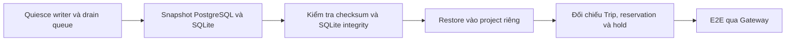

# Disaster recovery DS03

## Snapshot liên service

Quiesce writer, dừng consumer, drain queue, tạo logical dump PostgreSQL và SQLite backup. Archive có SHA-256. Restore vào project mới, xác minh archive và kiểm tra `PRAGMA integrity_check` trước khi ghi dữ liệu SQLite. Xác minh cùng `trip_id` qua Trip, Driver reservation và Payment hold rồi chạy booking mới qua Gateway. Khi snapshot đang online, backup của mỗi DB có thể nhất quán riêng nhưng không có điểm commit chung giữa service. Snapshot liên service tiếp tục yêu cầu quiesce và drain.

Baseline drill ghi lúc 19:06:53 ngày 10/11/2026 (UTC+7), RTO đo **209,5 giây** từ dựng target đến sẵn sàng và xác minh checkpoint. Chuyến `ACCEPTED`, reservation `CONFIRMED` và payment hold `HELD` còn đúng ở target. E2E được chạy lại trên target trong lượt nghiệm thu này. [Lệnh backup/restore Compose](BACKUP_RESTORE_REPORT.md)

Probe SQLite mới dùng file thật, tắt auto-checkpoint, commit hai bản ghi vào WAL đang mở rồi dùng backup API. Bản restore có **2/2** bản ghi, integrity check trả `ok`. Bản sao bị ghi đè header bị từ chối. Dữ liệu nguồn không bị chỉnh sửa bởi bước gây lỗi.

Đã đối chiếu lại sáu hash trong manifest của archive drill và chạy SQLite integrity check read-only trên hai file backup Identity/Trip. Cả hai trả `ok`.

Truy vấn read-only theo ID checkpoint trên target đã restore trả đúng **1 Trip ACCEPTED, 1 reservation CONFIRMED, 1 hold HELD**. Đây là số hàng của checkpoint, không phải tổng số hàng trong database.

## PostgreSQL PITR biệt lập

**PASS cho probe một database.** Dùng container PostgreSQL 17 mới, `--network none`, có full base backup và WAL archive. Tạo hàng 1, chụp base backup, tạo hàng 2, ghi timestamp mục tiêu rồi xóa hai hàng. Recovery sang data directory riêng chạy đến **19:37:15,870 ngày 10/11/2026 (UTC+7)**, promote và xác minh nguồn có 0 hàng sau xóa còn đích có đúng ID `1,2`. Đo **2 giây** từ lúc bắt đầu chạy tiến trình recovery trên bản base backup đã có đến khi xác minh. Lần đầu pipeline PowerShell thêm CR cuối script và làm lệnh thoát lỗi dù truy vấn đã đọc đúng dữ liệu. Lần chạy lại bằng file LF thoát mã 0.

```powershell
$name = 'ds03-pitr-acceptance-new'
docker run -d --name $name --network none -e POSTGRES_HOST_AUTH_METHOD=trust --entrypoint bash postgres:17-bookworm -ec 'install -d -o postgres -g postgres -m 0700 /tmp/ds03-wal; exec docker-entrypoint.sh postgres -c archive_mode=on -c "archive_command=cp %p /tmp/ds03-wal/%f"'
# Đợi pg_isready báo sẵn sàng trên socket cục bộ.
docker cp deploy/postgres-pitr-drill.sh "${name}:/tmp/pitr-drill.sh"
docker exec -u postgres $name bash /tmp/pitr-drill.sh
docker stop $name
```

Production cần base backup định kỳ, WAL archive ngoài failure domain, giám sát lag và diễn tập restore từ kho lưu trữ thật. **RPO production NOT RUN**. Khôi phục theo timestamp một database không thiết lập điểm rollback chung cho SQLite, RabbitMQ và PostgreSQL. Cần đối soát event và trạng thái nghiệp vụ trước khi mở write.

RabbitMQ definitions có thể tái tạo bằng script provision. Các definitions không chứa message backlog. Restore volume mới đã kiểm chứng ở baseline. Thử nghiệm xóa volume và phục hồi toàn bộ backlog vẫn **NOT RUN**. Các volume nguồn được giữ lại.


