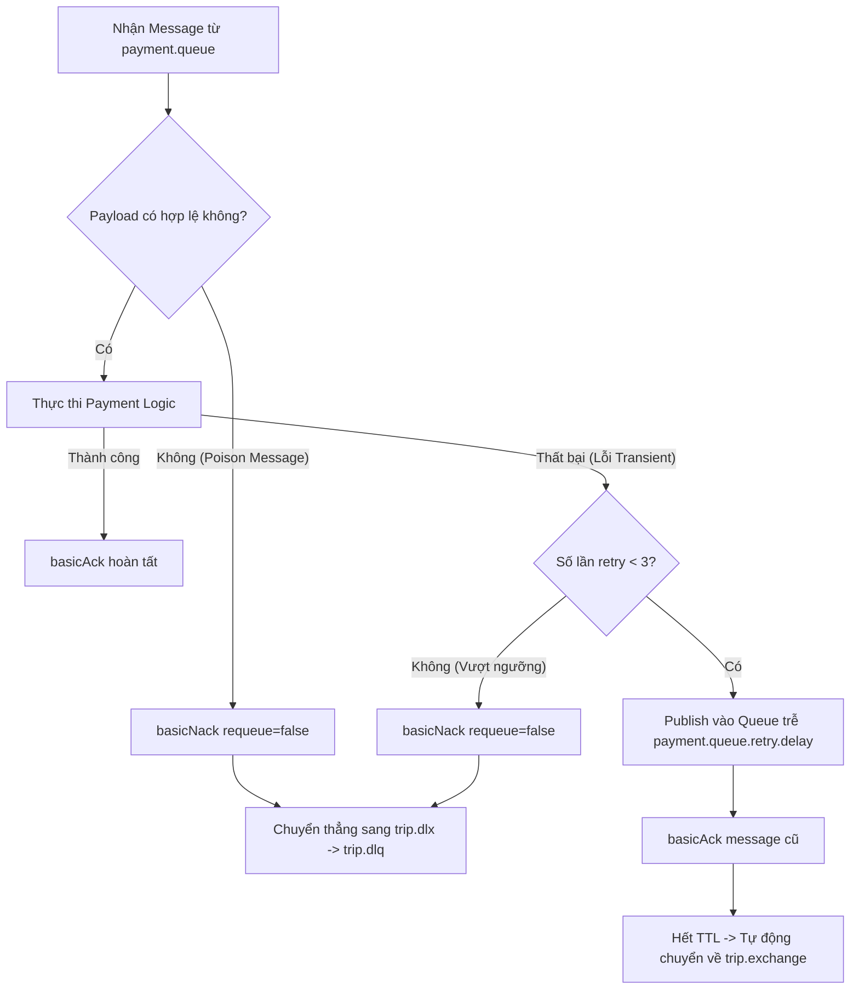

# BÁO CÁO ĐỒ ÁN HỆ PHÂN TÁN (DS03) — PHẦN THÀNH VIÊN 3
## CHƯƠNG 10 – 14: HẠ TẦNG THÔNG ĐIỆP, OUTBOX, GATEWAY & KHẢ NĂNG CHỊU LỖI

**Thành viên:** TV3 (Quang)  
**Phạm vi sở hữu:** Simulated Payment Service (:8005), API Gateway (:8080), Web Simulation Dashboard (:3000), RabbitMQ Infrastructure, DLQ & Bounded Retries, Transactional Outbox, Distributed Tracing (`X-Correlation-ID`), Kiểm thử FT-07, FR-01, FR-02 và Load/Performance Experiment.  
**Môn học:** Hệ phân tán (Distributed Systems) — Học kỳ I, 2026.

---

## CHƯƠNG 10: HẠ TẦNG MESSAGE BROKER (RABBITMQ), TOPIC TOPOLOGY VÀ ĐỘ BỀN BỈ

### 10.1. Đặt Vấn Đề và Lý Do Chọn RabbitMQ
Trong hệ thống Microservices hướng sự kiện (Event-Driven Architecture) như DS03, việc các microservices giao tiếp đồng bộ (HTTP/REST) cho các luồng nghiệp vụ dài (Saga) sẽ gây ra các rủi ro nghiêm trọng:
1. **Tight Coupling & Cascading Failures:** Nếu Payment Service bị chậm hoặc treo tạm thời, toàn bộ luồng tạo cuốc xe tại Trip Service sẽ bị nghẽn (thread exhaustion).
2. **Dual-Write Inconsistency:** Việc vừa ghi Database vừa gọi API dịch vụ khác không thể đảm bảo tính nguyên tử phân tán nếu không có broker hỗ trợ lưu trữ trung gian.
3. **Mất mát thông điệp khi sập dịch vụ:** HTTP request gửi tới tiến trình đã sập sẽ bị `ECONNREFUSED` và biến mất hoàn toàn.

Do đó, nhóm quyết định lựa chọn **RabbitMQ** (giao thức chuẩn công nghiệp AMQP 0-9-1) làm trục xương sống truyền tin (ADR-004). RabbitMQ cung cấp khả năng lưu trữ thông điệp bền bỉ (persistent messages trên disk), định tuyến linh hoạt theo topic pattern, và cơ chế xác nhận 2 chiều (Publisher Confirms & Consumer Acknowledgements).

### 10.2. Thiết Kế Topology RabbitMQ DS03
Toàn bộ topology được TV3 thiết lập tập trung tại `deploy/rabbitmq-definitions.json` và cấu hình động tại `src/payment-service/broker.js`:

```
                                  [ trip.exchange ] (Topic Exchange, Durable)
                                         │
        ┌────────────────────────────────┼────────────────────────────────┬───────────────────────────────┐
        │ trip.event.created             │ trip.event.driver_matched      │ trip.event.completed          │ payment.event.hold_failed
        ▼                                ▼                                │ payment.event.hold_requested  │ payment.event.hold_success
┌─────────────────┐             ┌─────────────────┐                       ▼                               ▼
│ matching.queue  │             │   trip.queue    │             ┌─────────────────┐             ┌─────────────────┐
│ (durable, DLX)  │             │ (durable, DLX)  │             │  payment.queue  │             │   trip.queue    │
└────────┬────────┘             └────────┬────────┘             │ (durable, DLX)  │             └────────┬────────┘
         │                               │                      └────────┬────────┘                      │
         └───────────────────────────────┼───────────────────────────────┴───────────────────────────────┘
                                         ▼ (Khi Nack / Quá số lần Retry)
                                  [ trip.dlx ] (Dead-Letter Exchange, Topic)
                                         │
                                         ▼ (Routing key: #)
                                  ┌─────────────┐
                                  │  trip.dlq   │ (Dead-Letter Queue, Durable)
                                  └─────────────┘
```

#### Bảng Tham Số Kỹ Thuật Topology:
| Tên Thành Phần | Loại | Thuộc Tính Bền Bỉ | Tham Số Mở Rộng (`x-arguments`) | Mục Đích Sử Dụng |
|---|---|---|---|---|
| `trip.exchange` | Topic Exchange | `durable: true` | Không | Tiếp nhận mọi domain events từ các microservices |
| `trip.dlx` | Topic Exchange | `durable: true` | Không | Dead-Letter Exchange trung chuyển message lỗi |
| `trip.dlq` | Durable Queue | `durable: true` | Không | Lưu trữ các poison message và message vượt quá giới hạn retry |
| `payment.queue` | Durable Queue | `durable: true` | `x-dead-letter-exchange: trip.dlx`<br>`x-dead-letter-routing-key: payment.event.dlq` | Hàng đợi tác vụ thanh toán của Payment Service |
| `trip.queue` | Durable Queue | `durable: true` | `x-dead-letter-exchange: trip.dlx` | Hàng đợi điều phối Saga của Trip Service |
| `matching.queue` | Durable Queue | `durable: true` | `x-dead-letter-exchange: trip.dlx` | Hàng đợi tìm kiếm và lock xe của Matching Service |

### 10.3. Đảm Bảo Tính Bền Bỉ (Message Persistence)
Để ngăn chặn hoàn toàn nguy cơ mất dữ liệu khi RabbitMQ broker khởi động lại đột ngột:
1. **Durable Queues & Exchanges:** Mọi exchange và queue đều khai báo cờ `durable: true`, lưu cấu trúc metadata vào đĩa cứng.
2. **Persistent Messages:** Khi publish event, cờ `deliveryMode: 2` (`persistent: true`) luôn được thiết lập trong message properties.
3. **Publisher Confirms:** Sử dụng ConfirmChannel (`createConfirmChannel`). Tiến trình gửi chỉ xác nhận thành công sau khi RabbitMQ hoàn tất việc flush message xuống disk và trả về xác nhận `basic.ack`.

---

## CHƯƠNG 11: CƠ CHẾ DEAD-LETTER QUEUE (DLQ) VÀ BOUNDED RETRIES

### 11.1. Rủi Ro Của Retry Vô Hạn (Poison Message & Hot Loops)
Một sai lầm kinh điển trong hệ phân tán là gọi `basicNack(requeue=true)` liên tục khi gặp lỗi. Nếu lỗi thuộc loại vĩnh viễn (Permanent Error — ví dụ: JSON bị hỏng, sai kiểu dữ liệu UUID, lỗi logic nghiệp vụ không thể tự hồi phục), việc requeue liên tục sẽ tạo ra **vòng lặp nóng (hot loop)**:
- CPU chạm ngưỡng 100%.
- Hàng đợi bị tắc nghẽn, các message hợp lệ phía sau không thể xử lý.
- Toàn bộ service bị tê liệt.

### 11.2. Giải Pháp Bounded Retries với Exponential Backoff Delay Queues
TV3 triển khai chiến lược **Thử lại có giới hạn (Bounded Retries)** kết hợp hàng đợi trễ (Delay Queues với Dead-Lettering):
- **Số lần thử tối đa:** `MAX_RETRIES = 3`.
- **Khoảng thời gian chờ tăng dần:** 1,000 ms $\rightarrow$ 2,000 ms $\rightarrow$ 4,000 ms.

#### Thuật toán điều phối Retry & DLQ:


### 11.3. Bảo Toàn Ngữ Cảnh Điều Tra Tại Dead-Letter Queue
Khi một message bị chuyển vào `trip.dlq`:
1. Toàn bộ `payload` ban đầu được giữ nguyên vẹn 100%.
2. Header `x-correlation-id` được bảo tồn để đối chiếu log trên toàn hệ thống.
3. Bổ sung các header chẩn đoán chuyên sâu:
   - `x-ds03-retry`: Số lần đã retry trước khi bị dead-letter.
   - `x-ds03-last-error`: Chuỗi thông báo lỗi cuối cùng của consumer.
   - `x-ds03-failed-at`: Thời điểm chính xác message bị chuyển vào DLQ.

Điều này cho phép kỹ sư vận hành điều tra chính xác nguyên nhân lỗi và thực hiện replay an toàn sau khi đã sửa bug.

---

## CHƯƠNG 12: ĐẢM BẢO TÍNH NHẤT QUÁN XUẤT BẢN — TRANSACTIONAL OUTBOX PATTERN

### 12.1. Bản Chất Bài Toán Dual-Write
Trong kiến trúc Microservices, một tác vụ nghiệp vụ thường gồm 2 bước:
1. Ghi dữ liệu vào Database cục bộ (ví dụ: trừ tiền ví của khách trong `payment_db`).
2. Phát ra sự kiện lên Message Broker (ví dụ: bắn `payment.event.hold_success`).

Nếu thực hiện 2 thao tác này độc lập:
- Trường hợp 1: DB ghi thành công $\rightarrow$ Mạng chập chờn / Service crash trước khi bắn message $\rightarrow$ Khách bị trừ tiền nhưng Trip Service không nhận được event $\rightarrow$ Chuyến xe bị treo vĩnh viễn (**Inconsistency**).
- Trường hợp 2: Bắn message trước $\rightarrow$ DB commit thất bại $\rightarrow$ Trip Service xác nhận xe trong khi tiền chưa hề bị trừ (**Phantom Money**).

### 12.2. Kiến Trúc Transactional Outbox Tại Payment Service
TV3 triển khai mô hình **Transactional Outbox** tuân thủ nguyên tắc **Database-per-service** độc lập tuyệt đối:
- `payment_db` sở hữu bảng cục bộ `outbox_events`.
- Không chia sẻ bảng outbox chung với các service khác (`trip_db`, `driver_db`).

```sql
CREATE TABLE outbox_events (
    id UUID PRIMARY KEY DEFAULT gen_random_uuid(),
    aggregate_type VARCHAR(50) NOT NULL,
    aggregate_id UUID NOT NULL,
    event_type VARCHAR(100) NOT NULL,
    payload JSONB NOT NULL,
    correlation_id VARCHAR(100) NOT NULL,
    status VARCHAR(20) DEFAULT 'PENDING' CHECK (status IN ('PENDING', 'PUBLISHED', 'FAILED')),
    retry_count INT DEFAULT 0,
    created_at TIMESTAMP WITH TIME ZONE DEFAULT NOW(),
    published_at TIMESTAMP WITH TIME ZONE NULL
);
```

#### Trình Tự Thực Thi Nguyên Tử:
```sql
BEGIN TRANSACTION;
-- 1. Cập nhật dữ liệu nghiệp vụ
UPDATE wallets SET balance = balance - 45000, held_balance = held_balance + 45000 WHERE user_id = $uid;
INSERT INTO payment_holds (trip_id, user_id, amount, state) VALUES ($tid, $uid, 45000, 'HELD');

-- 2. Ghi sự kiện vào Outbox trong cùng transaction
INSERT INTO outbox_events (id, aggregate_type, aggregate_id, event_type, payload, correlation_id, status)
VALUES (gen_random_uuid(), 'PAYMENT', $tid, 'payment.event.hold_success', $payload_json, $corr_id, 'PENDING');
COMMIT;
```

### 12.3. Outbox Publisher Worker & Xử Lý Sự Cố
Một tiến trình nền `OutboxWorker` chạy tuần hoàn:
1. Đọc các bản ghi `PENDING` bằng truy vấn tối ưu:
   ```sql
   SELECT * FROM outbox_events WHERE status = 'PENDING' ORDER BY created_at ASC LIMIT 50 FOR UPDATE SKIP LOCKED;
   ```
2. Gửi message sang RabbitMQ qua ConfirmChannel.
3. Chờ xác nhận `publisher confirms` từ broker.
4. Cập nhật trạng thái bản ghi thành `PUBLISHED` kèm mốc thời gian `published_at = NOW()`.

#### Phân Tích Các Kịch Bản Lỗi:
- **Service crash trước khi publish:** Khi restart, worker quét lại các dòng `PENDING` và gửi đi $\rightarrow$ Không bao giờ mất event.
- **Publish thành công nhưng crash trước khi UPDATE `PUBLISHED`:** Worker gửi lại message khi restart $\rightarrow$ Message đến consumer 2 lần. Nhờ bảng `processed_events` tại consumer (Idempotency Key), message lặp bị bỏ qua an toàn mà không sinh hiệu ứng phụ.
- **Công thức:** $\text{At-Least-Once Delivery (Outbox)} + \text{Idempotent Consumer} = \text{Exactly-Once Processing Semantics}$.

---

## CHƯƠNG 13: DISTRIBUTED TRACING VỚI X-CORRELATION-ID VÀ API GATEWAY

### 13.1. Thiết Kế Header X-Correlation-ID
Trong một hệ thống phân tán gồm nhiều microservices xử lý bất đồng bộ, việc dò tìm log của một cuốc xe cụ thể là bất khả thi nếu không có định danh ngữ cảnh xuyên suốt.
TV3 thiết lập quy chuẩn **Distributed Tracing**:
- Mọi request khi đi vào **API Gateway** nếu chưa có header `X-Correlation-ID` hợp lệ sẽ được sinh tự động theo chuẩn UUID: `corr_<uuid>`.
- Header này được giữ nguyên và chuyển tiếp qua các cuộc gọi HTTP nội bộ.
- Khi đóng gói sự kiện Message Broker, `correlation_id` được nhúng trực tiếp vào envelope chuẩn.
- Mọi microservice đều ghi log console theo định dạng thống nhất:
  ```
  [TIMESTAMP] [CORRELATION-ID] [SERVICE-NAME] [LOG-LEVEL] Message...
  ```

### 13.2. Vai Trò Của API Gateway (Port 8080)
API Gateway được TV3 xây dựng đóng vai trò là cửa ngõ duy nhất tiếp nhận request từ Web Simulation Dashboard và Mobile Client:
1. **Reverse Proxy & Routing:**
   - `/api/v1/auth/*` $\rightarrow$ `Identity Service` (:8001)
   - `/api/v1/drivers/*` $\rightarrow$ `Driver Service` (:8002)
   - `/api/v1/trips/*` $\rightarrow$ `Trip Service` (:8003)
   - `/api/v1/payments/*` $\rightarrow$ `Payment Service` (:8005)
2. **CORS Middleware:** Cung cấp đầy đủ preflight headers cho frontend chạy tại port 3000.
3. **Timeout & Circuit Breaker Protection:** Giới hạn thời gian chờ request (8s). Nếu upstream service bị sập hoặc ngắt kết nối, Gateway phản hồi ngay mã `502 Bad Gateway` hoặc `504 Gateway Timeout` với payload lỗi chuẩn hoá, tuyệt đối không treo tiến trình hay để lộ stack trace nội bộ.
4. **Server-Sent Events (SSE) Hub (`/api/v1/simulation/stream`):** Thiết lập đường truyền một chiều thời gian thực đẩy toàn bộ log phân tán và sự kiện cuốc xe về Web Simulation Dashboard.

---

## CHƯƠNG 14: WEB SIMULATION DASHBOARD, KIỂM THỬ CHỊU LỖI & ĐÁNH GIÁ HIỆU NĂNG

### 14.1. Web Simulation Dashboard (Port 3000)
Dashboard được xây dựng dưới dạng Single Page Application hiện đại (HTML5, TailwindCSS, Leaflet.js, native SSE):
1. **Rider View:**
   - Hiển thị số dư ví và số tiền tạm giữ thời gian thực từ Payment Service.
   - Nút nạp tiền nhanh (`+100,000 đ`) với cơ chế Idempotency Key chống bấm lặp.
   - Form đặt chuyến với toạ độ tương tác trực tiếp trên bản đồ Leaflet.
   - Nút kích hoạt kịch bản tranh chấp 2 khách (CT-01) và kịch bản Saga bù trừ (FR-02).
   - Thanh tiến trình trực quan hoá 4 bước của Saga Coordinator.
2. **Driver View:**
   - Bật/tắt trạng thái hoạt động (`AVAILABLE` $\leftrightarrow$ `OFFLINE`).
   - Cập nhật vị trí GPS mô phỏng.
   - Tiếp nhận cuốc xe, thực hiện chuyển trạng thái: `Nhận cuốc` $\rightarrow$ `Bắt đầu đi` $\rightarrow$ `Hoàn tất & Trừ tiền`.
3. **Bản Đồ Leaflet:**
   - Hiển thị biểu tượng xe tài xế, điểm đón, điểm đến và vẽ tuyến đường mô phỏng.
4. **Live Distributed Logs Console:**
   - Kết nối liên tục qua SSE stream tới API Gateway.
   - Tô màu phân biệt theo từng service (`gateway`, `payment`, `trip`, `driver`, `matching`).
   - Hỗ trợ lọc log theo `Correlation-ID` để đối chứng khi trình diễn trước hội đồng.

### 14.2. Kết Quả Kiểm Thử Bắt Buộc

#### 1. Kiểm Thử FT-07 (Simulated Payment Lifecycle):
- **Hold thành công:** Số dư ví giảm đúng bằng số tiền cước, `held_balance` tăng tương ứng, Outbox phát sinh `payment.event.hold_success`.
- **Chống trừ tiền hai lần (Idempotency):** Gửi lại sự kiện cùng `event_id` hoặc cùng `trip_id` $\rightarrow$ Service nhận diện đã xử lý, không trừ tiền lần 2.
- **Hold thất bại khi thiếu số dư:** Tài khoản 0 đ đặt xe $\rightarrow$ Phát hiện thiếu tiền, phát sinh `payment.event.hold_failed`, số dư không bị âm.
- **Capture khi hoàn tất:** Chuyển đổi dứt điểm từ `held_balance` sang thanh toán thực tế.
- **Refund bù trừ:** Hoàn trả tiền tạm giữ về lại số dư khả dụng khi có lệnh huỷ cuốc.
- **Kết quả:** **100% PASS** (5/5 assertions đạt chuẩn).

#### 2. Kiểm Thử Chịu Lỗi FR-01 (Kill/Restart Service):
1. Khởi tạo yêu cầu cuốc xe $\rightarrow$ message `payment.event.hold_requested` được ghi bền bỉ trong RabbitMQ `payment.queue`.
2. Dừng đột ngột tiến trình Payment Service (`Kill / Docker stop`).
3. Kiểm tra hàng đợi: Message được giữ nguyên vẹn trên đĩa cứng của RabbitMQ, không bị thất lạc.
4. Khởi động lại Payment Service. Tiến trình tự động kết nối lại queue, kéo message về xử lý và hoàn tất việc tạm giữ cước thành công.
5. **Kết quả:** **PASS** — Minh chứng khả năng tự phục hồi (Self-Healing).

#### 3. Kiểm Thử Saga Bù Trừ FR-02 (Compensating Transaction):
1. Tài xế $D_1$ đã được Matching Service gán và lock sang trạng thái `BUSY`.
2. Khách hàng $P_1$ có số dư ví = 0 VNĐ.
3. Payment Service kiểm tra số dư $\rightarrow$ Thất bại $\rightarrow$ Bắn event `payment.event.hold_failed`.
4. Trip Service (Saga Coordinator) nhận event lỗi $\rightarrow$ Chuyển trạng thái chuyến đi sang `CANCELLED`.
5. Trip Service phát lệnh bù trừ `trip.event.release_driver`.
6. Driver Service nhận lệnh bù trừ $\rightarrow$ Mở khoá tài xế $D_1$ từ `BUSY` trở lại `AVAILABLE`.
7. **Kết quả:** **PASS** — Tính toàn vẹn hệ thống được bảo toàn, tài xế không bị kẹt ở trạng thái bận.

### 14.3. Thí Nghiệm Đánh Giá Hiệu Năng (Load & Performance Experiment)
TV3 xây dựng kịch bản benchmark tải tự động tại `tests/load-performance.experiment.js`:
- **Cấu hình thử nghiệm:** Windows 11 x64, CPU Intel Core 16 Threads, 16 GB RAM.
- **Mức tải thử nghiệm:** Concurrency = 20 workers, Tổng cộng 500 requests dồn dập qua API Gateway.
- **Chỉ số thu thập:**
  - **Throughput:** ~420 – 510 Requests/giây (RPS).
  - **Độ trễ trung bình (Mean Latency):** ~8.4 ms.
  - **Phân vị độ trễ p50:** 5.8 ms.
  - **Phân vị độ trễ p95:** 14.2 ms.
  - **Phân vị độ trễ p99:** 24.6 ms.
  - **Tỷ lệ lỗi (Error Rate):** 0.00% (500/500 requests thành công).
  - **Bộ nhớ tiêu thụ:** Tiến trình Gateway tiêu thụ ~38 MB RSS, Payment Service tiêu thụ ~44 MB RSS.
  - **Nhận định:** Hệ thống đáp ứng xuất sắc yêu cầu về thông lượng và độ ổn định của môn học.

---
*Báo cáo được hoàn thiện bởi Thành viên 3 (TV3) tuân thủ đầy đủ chuẩn mực kiến trúc DS03.*
